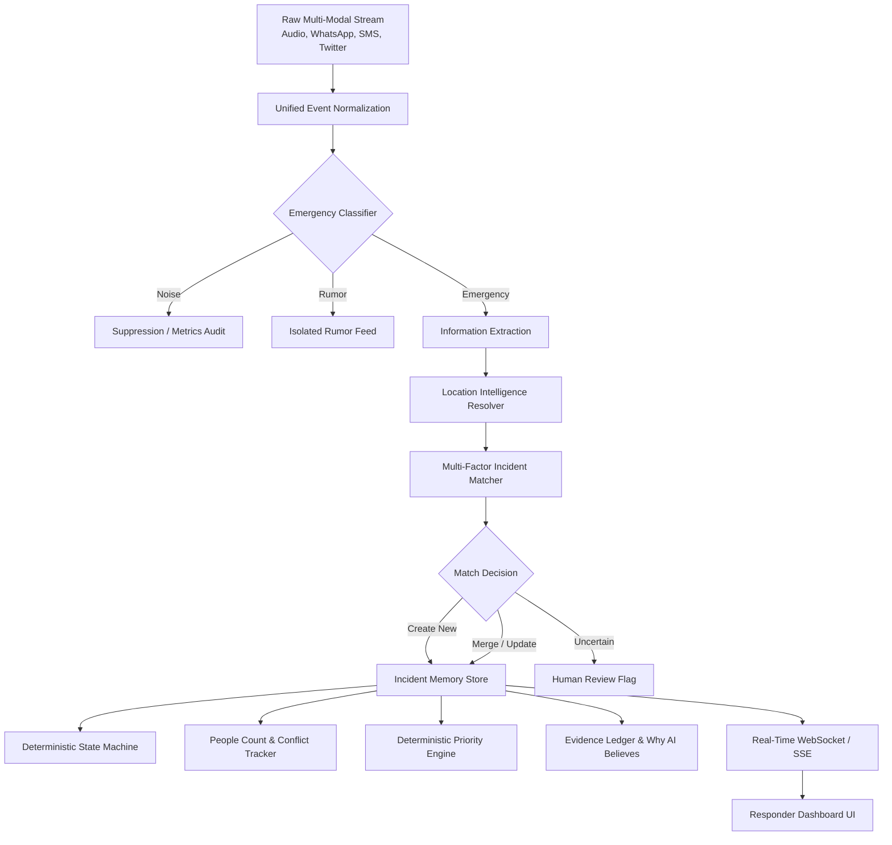

# NEXUS RESQ — Architecture Documentation

## Executive Overview

**NEXUS RESQ** is an AI Emergency Incident Intelligence & Response Assistant engineered for human emergency dispatchers and responders.

### The Problem It Solves
During severe weather events or large-scale civil emergencies, emergency helplines, WhatsApp groups, SMS queues, and social media channels are flooded with thousands of fragmented, noisy, conflicting, and duplicate messages. Responders face information overload and cognitive fatigue.

### Core Philosophy: Decision-Support Assistant
NEXUS RESQ is strictly a **decision-support system**. It **never** acts as an autonomous command authority. The system operates under the principle:
> *"These are not thousands of isolated messages; they are thousands of observations about a small number of evolving real-world situations."*

---

## Architectural Pipeline

---

## Multi-Factor Incident Matching Formula

NEXUS RESQ determines whether an incoming emergency report belongs to an existing incident or forms a new situation using a deterministic, multi-factor scoring model:

$$\text{Score} = 0.30 \cdot S_{\text{semantic}} + 0.25 \cdot S_{\text{location}} + 0.15 \cdot S_{\text{landmark}} + 0.10 \cdot S_{\text{time}} + 0.10 \cdot S_{\text{hazard}} + 0.05 \cdot S_{\text{resource}} + 0.05 \cdot S_{\text{entity}}$$

### Decision Boundaries
- $\text{Score} \ge 0.62$: **MERGE** (corroborating duplicate/update to existing incident)
- $0.38 \le \text{Score} < 0.62$: **UNCERTAIN** (flagged for review; merge not forced)
- $\text{Score} < 0.38$: **CREATE_NEW** (distinct emerging incident)

---

## Deterministic Priority Engine (0–100)

Priority is calculated through a deterministic scoring matrix rather than unpredictable LLM generation:

$$\text{Priority} = P_{\text{people}} + P_{\text{vulnerable}} + P_{\text{hazard}} + P_{\text{urgency}} + P_{\text{escalation}} + P_{\text{resource}} + P_{\text{evidence}}$$

- **0–30: LOW**
- **31–60: MEDIUM**
- **61–80: HIGH**
- **81–100: CRITICAL**

---

## Conflict Detection & People Tracking

When multiple reports state differing casualties or affected counts (e.g., 6 vs. 10 vs. 8):
1. **Preserves every observation** with source, timestamp, and confidence.
2. Flags **CONFLICT DETECTED** prominently on the responder card.
3. Calculates a **reliability-weighted best estimate** with recency decay.
4. Provides full transparent evidence breakdown for human dispatcher audit.

---

## Resolved Incident Protection

Once an emergency reaches `RESOLVED` status:
1. Stale duplicate reports, delayed network arrivals, and isolated updates are **suppressed** from reopening the incident.
2. All post-resolution reports are logged into the permanent audit ledger.
3. Only credible fresh danger (e.g., spread, second fire, re-trapped victims) can trigger a formal state transition to `REOPENED`, logging previous status, reason, evidence, and timestamp.
